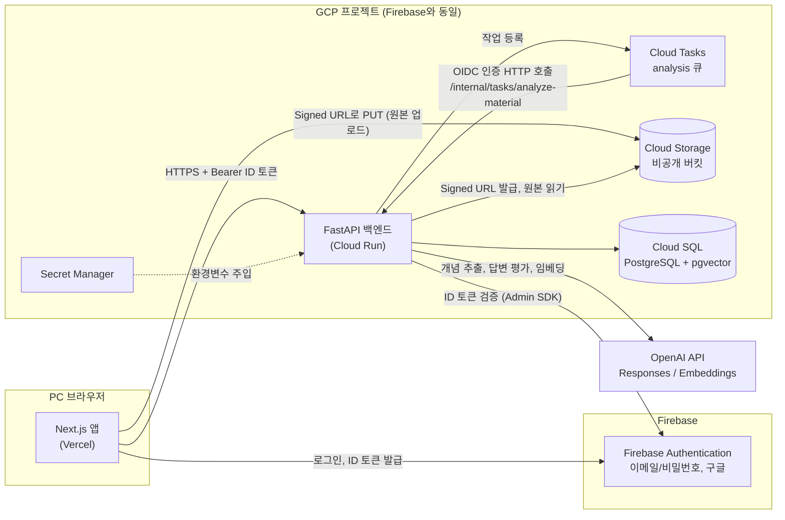
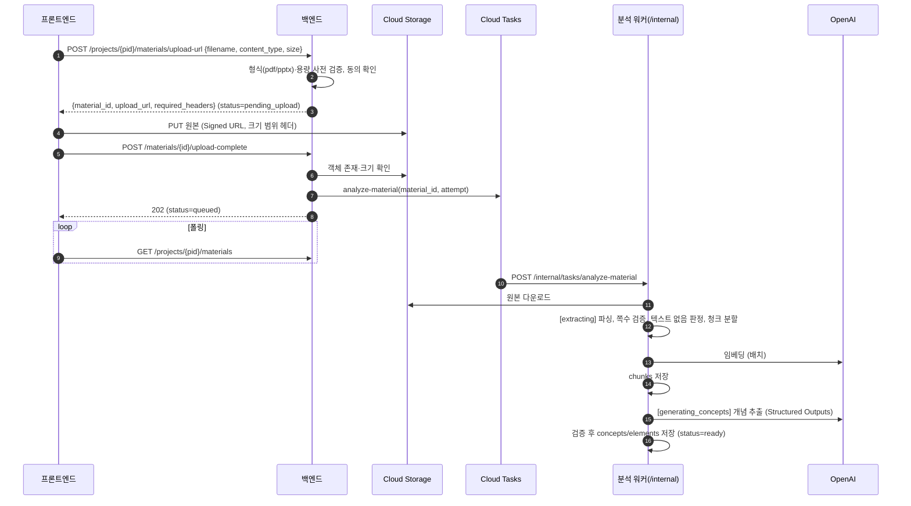
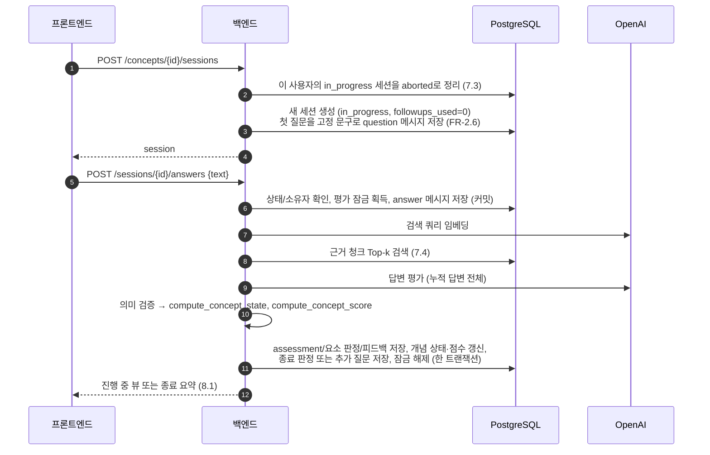
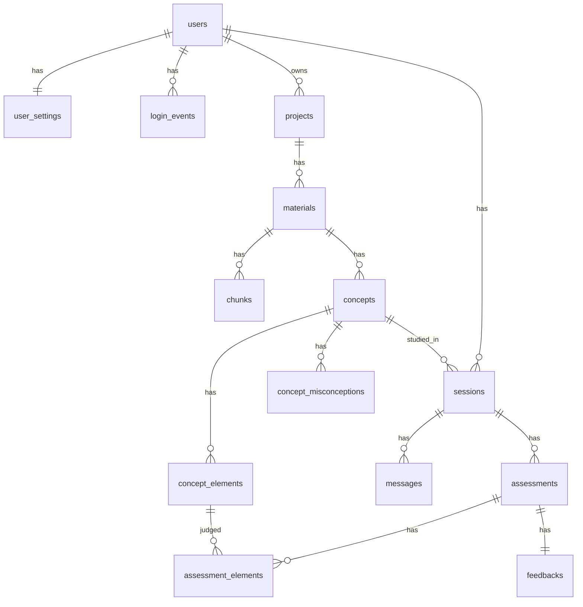

# Feynmi 시스템 아키텍처

> 문서 버전: v0.2 / 수정일: 2026-10-22
> 기준 문서: [prd.md](prd.md) v0.7, [design-system.md](design-system.md) v0.2

이 문서는 PRD를 **어떻게** 구현하는지(구성 요소, 데이터 흐름, 모듈 경계, API, 배포)를 정의한다. 요구사항, 판정/세션 규칙, 수치 기준은 PRD가 유일한 기준이며 여기서는 절 번호로 참조만 한다. 이 문서에서 내린 결정 중 수치나 정책에 해당하는 것은 PRD 9.4와 12장에도 기록했다. 충돌하면 PRD를 따른다.

---

## 1. 설계 원칙

| 원칙 | 적용 |
|---|---|
| 상태는 코드가 결정한다 | LLM은 요소별 판정만 반환하고, 개념 상태는 순수 함수 `compute_concept_state`가 산출한다 (PRD 6.1③). |
| LLM은 교체 가능한 외부 의존성이다 | 모든 생성/임베딩 호출은 `llm` 모듈 한 곳을 거친다. 모델 ID, effort, 키는 환경변수로만 주입한다 (PRD 9.2). |
| 공개 범위는 서버가 통제한다 | 세션이 완료되기 전에는 API 응답에서 (c)(d) 피드백을 아예 빼고 보낸다. 프론트엔드의 화면 처리에 의존하지 않는다 (PRD FR-3.3). |
| 소유권은 데이터 접근 계층에서 강제한다 | 사용자 데이터를 조회하는 모든 쿼리는 `user_id` 조건을 포함한다. 남의 리소스는 존재 여부도 드러내지 않고 404로 응답한다 (PRD FR-4.2). |
| 오래 걸리는 작업은 요청 밖에서 한다 | 자료 분석은 Cloud Tasks로 비동기 처리하고, 답변 평가는 동기 요청으로 처리한다. |
| 1개월 MVP에 맞춘다 | 서비스는 백엔드 하나와 프론트엔드 하나만 둔다. 워커는 같은 백엔드 이미지의 내부 엔드포인트로 처리하고, 큐는 관리형 서비스(Cloud Tasks)를 쓴다. |

---

## 2. 시스템 구성



| 구성 요소 | 역할 | 배포 |
|---|---|---|
| 프론트엔드 | UI, Firebase 클라이언트 인증, 백엔드 API 직접 호출, GCS 직접 업로드, 분석 상태 폴링 | Vercel |
| 백엔드 API | 인증/인가, 자료·세션·홈 API, 답변 평가(동기), Signed URL 발급 | Cloud Run (Docker) |
| 분석 워커 | 텍스트 추출 → 청크/임베딩 → 개념 추출. 백엔드와 **같은 서비스**의 내부 엔드포인트로 동작 | Cloud Run (같은 서비스) |
| 작업 큐 | 분석 작업 전달, 인프라 장애 시 재전달 | Cloud Tasks |
| DB | 관계형 데이터와 청크 임베딩 저장 | Cloud SQL for PostgreSQL (pgvector) |
| 파일 저장소 | 업로드 원본 보관. 분석 재시도 시 원본으로 다시 처리 | Cloud Storage 비공개 버킷 |
| 인증 | 계정, 이메일 인증, 비밀번호 재설정, 구글 로그인 | Firebase Authentication |
| LLM | 개념 추출, 답변 평가, 임베딩 (모델은 PRD 9.2) | OpenAI API |

---

## 3. 저장소 구조

```
Feynmi/
├─ apps/
│  ├─ frontend/                 # Next.js (pnpm)
│  │  ├─ app/                   # 라우트 (4.1). globals.css에 디자인 토큰
│  │  ├─ components/            # 공통 컴포넌트 (design-system.md 8장), icon.tsx(시안 SVG)
│  │  └─ lib/
│  │     ├─ firebase.ts         # Firebase 클라이언트 초기화
│  │     ├─ api.ts              # fetch 래퍼: ID 토큰 첨부, 오류 코드 → 한국어 메시지
│  │     └─ upload.ts           # Signed URL 업로드
│  └─ backend/                  # FastAPI (uv)
│     ├─ src/backend/
│     │  ├─ main.py             # 앱 팩토리, 라우터/CORS/예외 핸들러 등록
│     │  ├─ config.py           # pydantic-settings (환경변수, 10장)
│     │  ├─ api/                # 라우터: me, settings, projects, materials, concepts, sessions, records, home, internal
│     │  │  └─ deps.py          # get_db, get_current_user, require_verified_email
│     │  ├─ auth/firebase.py    # ID 토큰 검증
│     │  ├─ domain/             # 순수 로직. I/O 없음, 단위 테스트 대상
│     │  │  ├─ enums.py
│     │  │  ├─ state_rules.py   # compute_concept_state (PRD 6.1③, FM-035)
│     │  │  ├─ score_rules.py   # compute_concept_score, 평균 규칙 (PRD 6.1⑥, FM-036)
│     │  │  ├─ session_rules.py # 세션 전이·종료 조건 (PRD 6.2, FR-2.4)
│     │  │  ├─ ranking.py       # 취약 개념 정렬, 추천 (PRD FR-4.3, FR-3.4)
│     │  │  └─ stats.py         # 학습일·연속일·주간 위젯·알림 조건 (PRD FR-4.8, FR-4.9)
│     │  ├─ services/           # 유스케이스: projects, materials, analysis, sessions, records, home, account
│     │  ├─ ingest/             # pdf.py(pypdf), pptx.py(python-pptx), chunker.py
│     │  ├─ rag/                # embed.py, retrieve.py
│     │  ├─ llm/                # LLM 모듈 (6장)
│     │  │  ├─ provider.py      # 공급자 인터페이스
│     │  │  ├─ openai_provider.py
│     │  │  ├─ schemas.py       # 출력 Pydantic 모델 (= JSON 스키마)
│     │  │  ├─ prompts/         # 작업별 시스템 프롬프트
│     │  │  └─ tasks.py         # extract_concepts, assess_answer
│     │  ├─ storage/gcs.py      # Signed URL, 원본 다운로드
│     │  ├─ queue/              # cloud_tasks.py, inline.py (로컬)
│     │  └─ db/
│     │     ├─ models.py        # SQLAlchemy 2.0 모델
│     │     ├─ session.py       # async 엔진 (asyncpg)
│     │     └─ repositories/    # user_id 범위 쿼리
│     ├─ migrations/            # Alembic
│     ├─ tests/
│     └─ Dockerfile
├─ packages/
│  └─ api-types/                # OpenAPI에서 생성한 TypeScript 타입 (8.3)
├─ docs/
├─ compose.yaml                 # 로컬: frontend, backend, postgres(pgvector)
└─ .github/workflows/ci.yml
```

---

## 4. 프론트엔드

### 4.1 라우트

| 경로 | 화면 | 인증 | 관련 |
|---|---|---|---|
화면 구성은 [design-system.md](design-system.md) 9장을 따른다. "인증 완료"는 이메일 인증과 닉네임 설정을 모두 마친 상태다.

| 경로 | 화면 (design-system 9장) | 인증 | 관련 |
|---|---|---|---|
| `/login` | 로그인 (9.2) | 비로그인 | FR-4.1, FR-4.4 |
| `/signup` | 회원가입 3단계 (9.4). ② 단계는 로그인한 미인증 계정도 사용 | 비로그인 / 미인증 | FR-4.1 |
| `/reset-password` | 비밀번호 재설정 (9.5) | 비로그인 | FR-4.1 |
| `/onboarding` | 닉네임 설정 (9.6) | 로그인, 닉네임 없음 | FR-4.1 |
| `/terms`, `/privacy` | 정적 페이지 (9.15) | 공개 | FR-4.4 |
| `/` | 홈 (9.7) | 인증 완료 | FR-4.3, FR-4.8, FR-4.9 |
| `/projects` | 프로젝트 목록 (9.9) | 인증 완료 | FR-1.0 |
| `/projects/[id]` | 프로젝트 상세: 개념·학습자료·학습기록 탭 (9.10). `?tab=` 쿼리로 탭 지정 | 인증 완료 | FR-1.0~1.8, FR-4.5 |
| `/sessions/[id]` | 진행 중이면 세션 화면(9.11), 중단이면 읽기 전용 상세(9.13), 완료면 결과로 이동 | 인증 완료 | F2, FR-3.3, FR-4.5 |
| `/sessions/[id]/result` | 결과 (9.12) | 인증 완료, 완료 세션만 | FR-3.5 |
| `/records` | 학습기록 (9.13) | 인증 완료 | FR-4.5 |
| `/settings` | 설정 (9.14) | 인증 완료 | FR-4.6, FR-4.7 |

- 글꼴은 루트 레이아웃에서 `next/font/google`로 Noto Sans KR과 Plus Jakarta Sans를 불러와 CSS 변수로 노출한다 (design-system 2.1).
- 사이드바, 상단 바, 주간 위젯은 로그인 이후 화면 공통 레이아웃에 둔다. 주간 위젯 데이터는 `GET /me/summary`로 받는다 (8.1).

### 4.2 인증 처리
- Firebase JS SDK로 로그인하고, API 호출 직전에 `getIdToken()`으로 토큰을 받아 `Authorization: Bearer`로 보낸다. 토큰 갱신은 SDK가 처리한다.
- 보호 라우트는 클라이언트 측 가드로 처리한다. 로그인하지 않았으면 `/login`으로, 이메일 미인증이면 `/signup`의 ② 단계로, 닉네임이 없으면 이메일 가입자는 `/signup`의 ③ 단계로, 구글 가입자는 `/onboarding`으로 보낸다. 실제 차단은 백엔드가 한다 (5.2).
- 인증 메일 링크를 누른 뒤 "인증 완료했어요"를 누르면 `user.reload()`와 `getIdToken(true)`로 `email_verified` 클레임을 갱신한다. 재발송은 `sendEmailVerification`이며, 재발송 대기(PRD FR-4.1)는 프론트에서 센다.
- 로그인에 성공하면 `POST /me/login-events`를 한 번 호출한다 (FR-4.1). 토큰 자동 갱신은 로그인으로 세지 않는다.

### 4.3 서버 상태
- 프로젝트 상세의 학습자료 탭과 개념 탭은 분석 중인 자료가 있는 동안 `GET /projects/{id}/materials`를 폴링한다(간격은 프론트 상수, 모든 자료가 끝나거나 실패하면 중지).
- 설정 변경은 바뀔 때마다 즉시 `PATCH /me/settings`로 저장하고 토스트를 띄운다(FR-4.6). 연속 입력(학습 목표 −/＋)은 짧게 디바운스한다.
- 답변 제출은 평가가 끝날 때까지 기다리는 동기 요청이다. 대기 중에는 로딩 상태를 보여주고 중복 제출을 막는다.
- 오류 응답의 `code`(8.2)를 한국어 안내 문구와 재시도 버튼으로 바꾸는 매핑을 `lib/api.ts` 한 곳에 둔다 (PRD 7장 신뢰성, FM-060).

### 4.4 세션 이탈 처리 (PRD 6.2 중단)
- "학습 종료" 확인 모달에서 확인했을 때와, 사이드바·브레드크럼 등으로 앱 안의 다른 화면으로 이동할 때 `POST /sessions/{id}/abort`를 호출한다.
- 탭 닫기와 새로고침에서는 `pagehide` 이벤트에서 `fetch(..., { keepalive: true })`로 같은 요청을 보낸다. `navigator.sendBeacon`은 `Authorization` 헤더를 붙일 수 없어서 쓰지 않는다.
- 클라이언트 요청이 누락되어도 서버가 지연 정리로 닫는다 (7.3). 따라서 새로고침하면 세션이 중단된다. 이어하기는 MVP 제외 항목이므로 이 동작을 그대로 둔다 (PRD 5.2).

---

## 5. 백엔드

### 5.1 계층

```
api (라우터, 요청/응답 스키마, 인증 의존성)
  → services (유스케이스, 트랜잭션 경계)
      → domain (순수 규칙: 상태 산출, 세션 전이)
      → repositories (DB, user_id 범위 강제)
      → llm / rag / ingest / storage / queue (외부 I/O 어댑터)
```

- `domain`은 다른 계층을 import하지 않는다. 규칙 함수의 입력과 출력은 값 객체다.
- `services`만 트랜잭션을 연다. LLM 호출 중에는 DB 트랜잭션이나 행 잠금을 잡고 있지 않는다 (7.2).

### 5.2 인증과 인가 (PRD FR-4.1, FR-4.2)
1. `get_current_user`: `Authorization` 헤더의 ID 토큰을 Firebase Admin SDK `verify_id_token`으로 검증한다. 동기 함수이므로 스레드풀에서 실행한다. 토큰이 없거나 유효하지 않으면 `401 unauthenticated`를 반환한다.
2. 검증된 `uid`로 `users` 행을 upsert하고 이메일과 로그인 수단(`firebase.sign_in_provider`)을 동기화한다.
3. **토큰 폐기 확인**(모든 기기에서 로그아웃, FR-4.6): 토큰의 `auth_time`이 `users.tokens_revoked_at`보다 이전이면 `401 token_revoked`를 반환한다. Firebase의 `check_revoked=True`는 요청마다 Firebase를 추가로 호출하므로 쓰지 않고 DB 값으로 비교한다. Firebase 쪽 refresh token도 `revoke_refresh_tokens`로 함께 폐기해서 새 토큰이 발급되지 않게 한다.
4. `require_verified_email`: 토큰의 `email_verified`가 false면 `403 email_not_verified`를 반환한다. `/me` 계열을 뺀 모든 사용자 API에 적용한다. 구글 로그인 계정은 Firebase가 인증된 상태로 발급한다.
5. `require_profile`: `users.nickname`이 없으면 `403 profile_required`를 반환한다. `/me` 계열을 뺀 모든 사용자 API에 적용한다.
6. 업로드 URL 발급은 `users.ai_consent_at`이 없으면 `403 ai_consent_required`를 반환한다 (FR-1.8).
7. 리소스 접근: 리포지토리 함수는 `user_id`를 필수 인자로 받는다. `projects`와 `sessions`는 `user_id` 컬럼으로 바로 확인하고, 하위 리소스(자료, 개념)는 `projects.user_id`를 조인해서 확인한다. 조건에 맞지 않으면 `404 not_found`를 반환한다.
8. 내부 엔드포인트 `/internal/*`: Cloud Tasks가 붙인 OIDC 토큰을 검증한다(audience = 백엔드 URL, 발급 서비스 계정 = 큐 전용 SA). Firebase 인증은 적용하지 않는다.
9. CORS: `CORS_ORIGINS`에 있는 Vercel 도메인(운영, 프리뷰)과 로컬 주소만 허용한다.

---

## 6. LLM 모듈 (PRD F5, 9.2)

### 6.1 인터페이스

```python
class LLMProvider(Protocol):
    async def generate_structured(
        self, *, task: LLMTask, system: str, input: str, schema: type[BaseModel]
    ) -> BaseModel: ...
    async def embed(self, texts: list[str]) -> list[list[float]]: ...
```

- `LLMTask`는 `concept_extraction`과 `assessment` 두 가지다. 작업별 모델 ID와 `reasoning.effort`는 설정(`LLM_<TASK>_MODEL`, `LLM_<TASK>_EFFORT`)에서 가져온다. 코드에는 기본값을 두지 않으며, 값이 없으면 기동할 때 실패한다.
- `OpenAIProvider`는 Responses API의 Structured Outputs(strict JSON 스키마, Pydantic 모델에서 생성)를 쓰고, 임베딩은 Embeddings API를 쓴다. temperature에 의존하지 않는다 (PRD 6.1⑤).
- 공급자를 바꿀 때는 `LLMProvider` 구현만 추가한다 (PRD FR-5.3). 서비스 계층은 `llm.tasks`의 함수만 호출한다.

### 6.2 재시도와 검증 (PRD FR-5.4)
- 다음 중 하나가 발생하면 재시도한다. 최대 횟수는 `LLM_MAX_RETRIES`이며 초기값은 PRD 9.4를 따른다. 재시도 사이에는 지수 백오프를 둔다.
  - 네트워크 오류, 타임아웃, 429, 5xx
  - 응답이 JSON 스키마 파싱에 실패
  - 의미 검증 실패 (아래 표)
- 재시도를 모두 실패하면 `LLMError`를 던진다. 서비스 계층은 이를 사용자용 오류 코드(`llm_failed`)로 바꾼다.

| 작업 | 스키마 밖 의미 검증 |
|---|---|
| 개념 추출 | 개념 수가 PRD FR-1.5 범위 안, 개념당 요소 수와 오개념 수가 PRD 6.1① 범위 안, 핵심 요소 1개 이상, 참조한 청크 ID가 모두 입력에 존재 |
| 답변 평가 | 체크리스트의 모든 요소에 판정이 정확히 1개씩 존재, `learner_quote`가 세션 누적 답변의 부분 문자열(공백 정규화 후), 참조한 청크 ID가 입력에 존재 |

### 6.3 개념 추출 (PRD 6.1①, FR-1.5)
- 입력: 청크 전체를 한 번에 넣는다. 각 청크 앞에 짧은 라벨(`[C1]`, `[C2]` …)과 쪽/슬라이드 번호를 붙인다. 라벨은 서버에서 실제 `chunk_id`로 바꾼다.
- 출력 스키마(`ConceptExtractionOutput`):

```
concepts[]:
  title, description            # 기준 설명
  elements[]: text, importance(core|supporting), evidence_chunks[label]
  misconceptions[]: text, evidence_chunks[label]
```

### 6.4 답변 평가 (PRD 6.1②, FR-3.2~3.3, FR-5.5)
- 입력: 개념의 기준 설명, 체크리스트(요소 ID 포함), 흔한 오개념, 근거 청크(7.4), **현재 세션**의 누적 답변 전체와 그 사이의 추가 질문, 사용자의 AI 질문 난이도(`basic`/`deep`, PRD FR-4.6).
- 난이도는 `followup_question` 작성 지침에만 들어간다. 요소 판정 지침과 스키마는 난이도와 관계없이 같다 (판정 일관성).
- 출력 스키마(`AssessmentOutput`):

```
elements[]: element_id, verdict(met|partial|missing|contradicted),
            learner_quote | null, evidence_chunks[label], note
unverified_statements[]: learner_quote, note     # "자료에서 확인되지 않음"
feedback:
  correct[]        # (a) 맞은 부분
  missing_hint[]   # (b) 진행 중 공개용 힌트. 정답을 드러내지 않음
  missing[]        # (b) 종료 시 공개용 상세
  incorrect[]      # (c)
  supplement       # (d)
summary_points[]   # 종료 시 핵심 보완 포인트
followup_question | null
```

- 프롬프트 정책(FM-034, FM-054): 판정은 보수적으로 하고(의심스러우면 한 단계 낮게), 자료 문장을 그대로 옮긴 진술은 `met`으로 인정하지 않는다. 추가 질문은 핵심 요소 중 `missing`이나 `contradicted`인 것을 우선하고 정답을 포함하지 않는다. 자료에 없는 진술은 `unverified_statements`로만 보고한다.
- (b)를 힌트와 상세 두 필드로 나눈 이유: 진행 중과 종료 시 공개 수준이 다르기 때문이다(FR-3.3). 서버는 세션 상태에 따라 내려보낼 필드를 고른다 (8.1).
- 종료 요약은 마지막 평가의 `feedback`과 `summary_points`를 그대로 쓴다. 종료 시점에 LLM을 추가로 호출하지 않는다.

### 6.5 상태 산출 (PRD 6.1③, FM-035)

```python
def compute_concept_state(
    has_answer: bool,
    verdicts: Sequence[tuple[Importance, Verdict]],
) -> ConceptState: ...
```

- PRD 6.1③ 표의 순서를 그대로 구현한다. 보조 요소는 무시한다. `unverified_statements`는 입력으로 받지 않으므로 상태에 영향을 줄 수 없다.
- 이 함수는 순수 함수이며, PRD 표의 4개 분기와 "보조 요소만 모순인 경우"를 모두 단위 테스트로 검증한다.

### 6.6 점수 산출 (PRD 6.1⑥, FM-036)

```python
def compute_concept_score(verdicts: Sequence[tuple[Importance, Verdict]]) -> int: ...
def average_score(scores: Iterable[int | None]) -> int | None: ...  # None(미학습) 제외, 없으면 None
```

- `compute_concept_score`는 핵심 요소만 쓰고 PRD 6.1⑥의 판정 점수로 평균을 내어 반올림한다(0.5는 올림). 평가가 저장될 때 상태와 함께 계산해 `assessments.score`에 저장한다.
- 프로젝트 이해도와 전체 이해도는 저장하지 않고 조회할 때 `concepts.score`로 계산한다.
- 세션 점수 변화는 그 세션의 `assessments` 중 `seq` 최소와 최대의 점수 차이다.

---

## 7. 핵심 흐름

### 7.1 업로드와 분석 (PRD F1, FR-5.1)



**자료 상태**

| 상태 | 화면 단계 (FR-1.7) | 설명 |
|---|---|---|
| `pending_upload` | 업로드 중 | URL은 발급했지만 업로드 완료 통지가 없음 |
| `queued` | 추출 | 큐에 등록됨 |
| `extracting` | 추출 | 파싱, 청크 분할, 임베딩 |
| `generating_concepts` | 개념 생성 | 개념/체크리스트 생성 |
| `ready` | 완료 | 개념 목록 확인 가능 |
| `failed` | 실패 | `failure_code`와 재시도 버튼 |

**실패 코드**: `unsupported_format`, `file_too_large`, `too_many_pages`, `no_extractable_text`(스캔 PDF, FR-1.4), `corrupted_file`, `llm_failed`, `internal_error`.

**설계 요점**
- **Signed URL**: V4 PUT URL에 `Content-Type`과 `x-goog-content-length-range`(0~PRD FR-1.2 상한)를 서명에 포함시켜 GCS가 용량을 강제하게 한다. 객체 경로는 `users/{user_id}/projects/{project_id}/materials/{material_id}/original.{ext}`이다. 여러 파일을 한 번에 올리면 파일마다 이 흐름을 따로 실행한다(동시 업로드 수는 프론트 상수로 제한). 버킷은 공개 접근 차단 상태이고, 프론트 도메인의 PUT만 허용하도록 CORS를 설정한다. 원본 다운로드 URL은 발급하지 않는다(MVP에 원본 열람 기능 없음).
- **쪽수 검증**은 파일을 열어 봐야 알 수 있으므로 워커의 `extracting` 단계에서 한다.
- **텍스트 없음 판정**: 추출한 텍스트가 사실상 비어 있으면 `no_extractable_text`로 실패 처리한다.
- **청크 분할**: 쪽/슬라이드 경계를 우선하고, 길면 토큰 기준(tiktoken)으로 자르며 오버랩을 둔다. 수치는 PRD 9.4를 따른다. 청크에는 쪽/슬라이드 범위를 기록해서 근거 표시에 쓴다.
- **멱등성**: 작업 페이로드에 `attempt`(재시도 버튼을 누를 때마다 증가)를 넣는다. 워커는 DB의 `analysis_attempt`와 다르거나 이미 `ready`인 작업을 무시한다. 시작할 때 해당 자료의 기존 청크와 개념을 지우고 다시 만든다.
- **재시도 경계**: 사용자 원인 실패(형식, 쪽수, 텍스트 없음)와 LLM 최종 실패는 `failed`로 기록하고 2xx를 반환해서 Cloud Tasks가 재전달하지 않게 한다. 인스턴스 장애처럼 응답 없이 끊긴 경우는 Cloud Tasks가 재전달한다.
- **멈춘 작업**: 진행 상태인데 `updated_at`이 작업 데드라인(9.3)을 넘긴 자료는 조회할 때 `failed/internal_error`로 바꾼다. 사용자는 재시도 버튼으로 복구한다 (FR-1.3).
- **재시도 버튼**: `POST /materials/{id}/retry`는 `failed` 상태에서만 허용한다. `analysis_attempt`를 1 올리고 보관된 원본으로 작업을 다시 등록한다.

### 7.2 세션과 답변 평가 (PRD F2, F3, 6.1, 6.2)



**세션 전이** (`domain/session_rules.py`)

평가가 하나 끝날 때마다 다음 순서로 판단한다.
1. 산출 상태가 `understood`이면 `completed`(종료 사유 `understood`)로 바꾼다.
2. 아니고 `followups_used`가 PRD FR-2.4의 상한에 도달했으면 `completed`(종료 사유 `max_followups`)로 바꾼다.
3. 둘 다 아니면 `followup_question`을 `question` 메시지로 저장하고 `followups_used`를 1 올린다. 세션은 `in_progress`로 둔다.

이렇게 하면 판정은 최대 "최초 1회 + 재답변 상한"회가 된다 (FR-2.4).

**개념 상태 반영**: 평가가 저장될 때마다 같은 트랜잭션에서 `concepts.state`, `concepts.score`, `concepts.last_assessed_at`을 그 평가의 값으로 갱신한다. `concepts.first_assessed_at`은 비어 있을 때만 채운다(학습 통계의 "이번 주 처음 판정받은 개념"). 평가가 저장된 세션은 항상 그 개념의 가장 최근 세션이므로 PRD 6.2의 "가장 최근 세션의 마지막 판정"과 일치한다. 평가가 하나도 없는 세션은 상태를 바꾸지 않는다.

**동시성**
- 사용자당 `in_progress` 세션은 하나다. 부분 유니크 인덱스로 강제한다 (9장).
- 같은 세션에 답변이 중복 제출되는 것은 `sessions.evaluating_since`를 조건부 UPDATE(`WHERE evaluating_since IS NULL`)로 잡아서 막는다. 실패하면 `409 evaluation_in_progress`를 반환한다. 잠금이 평가 타임아웃보다 오래되면 만료된 것으로 본다.
- LLM 호출 중에는 DB 트랜잭션을 열어 두지 않는다. 평가가 실패하면 잠금을 풀고 `llm_failed`를 반환한다. 이미 저장된 답변 메시지는 평가가 없는 답변으로 남고, 다음 제출 때 누적 답변에 포함된다. 사용자는 같은 화면에서 다시 제출할 수 있다.

**재학습**: 새 세션은 자기 세션의 메시지만 평가 입력으로 쓴다 (PRD 6.2). 이전 세션, 평가, 피드백 행은 지우지 않고 이력으로 남긴다.

### 7.3 세션 중단 (PRD 6.2)

| 계기 | 처리 |
|---|---|
| `POST /sessions/{id}/abort` (버튼, 화면 이동, `pagehide` keepalive) | `in_progress`이면 `aborted`(종료 사유 `user_exit`)로 바꾼다. 이미 종료된 세션이면 아무것도 하지 않는다(멱등) |
| 같은 사용자가 새 세션을 시작 | 남아 있는 `in_progress` 세션을 `aborted`(종료 사유 `superseded`)로 바꾼다 |
| 같은 사용자가 홈을 조회 | 남아 있는 `in_progress` 세션을 `aborted`(종료 사유 `stale`)로 바꾼다 |

- 개념 상태는 평가 시점에 이미 반영되어 있으므로 중단할 때 따로 계산하지 않는다. 결과는 "마지막 판정 반영, 평가가 없으면 그대로"가 되어 PRD 6.2와 일치한다.
- 평가가 진행 중인 세션(`evaluating_since` 유효)은 중단하지 않고, 평가가 끝난 뒤 다음 계기에서 정리한다.

### 7.4 근거 검색 (PRD FR-5.2)
- 검색 쿼리: 개념 제목, 기준 설명, 현재 세션의 최신 답변을 이어 붙여 임베딩한다.
- 검색 범위: 개념이 속한 **프로젝트의 `ready` 자료 청크** 전체다(`chunks.project_id = :pid`, PRD FR-5.2). 코사인 거리로 정렬하고 `RAG_TOP_K`개를 가져온다 (PRD 9.4).
- 체크리스트 요소의 근거 청크(6.1①)는 항상 포함하고, 검색 결과와 합쳐 중복을 없앤다. 근거 청크에는 자료명과 쪽/슬라이드를 붙여 화면의 "연결된 학습자료"에 쓴다.
- 프로젝트 하나의 청크 수는 자료 수 × 수백 개 수준이므로 프로젝트로 필터링한 뒤 정확 검색으로 시작한다. 검색이 느려지면 `chunks.embedding`에 HNSW 인덱스를 추가한다.

### 7.5 홈과 통계 (PRD FR-4.3, FR-4.8, FR-4.9)
- `GET /home` 한 번으로 학습 개요, 알림, 다음 학습 추천, 프로젝트 카드, 취약 개념을 모두 반환한다. 조회 전에 7.3의 지연 정리를 수행한다.
- 프로젝트 카드의 상태 분포와 프로젝트 이해도는 `concepts`를 프로젝트별로 `GROUP BY`해서 계산한다.
- 취약 개념 정렬과 추천은 `domain/ranking.py`가 PRD FR-4.3, FR-3.4대로 계산한다. 결과 화면 추천은 방금 학습한 개념을 뺀다.
- 학습 통계는 `domain/stats.py`가 계산한다. 입력은 사용자의 판정 시각 목록(`assessments.created_at`을 `sessions.user_id`로 거른 것)과 `concepts.first_assessed_at`이다. 날짜는 `Asia/Seoul` 기준, 한 주는 월~일이다. 판정 시각만 쓰므로 별도 통계 테이블을 두지 않는다.
- 알림 조건(FR-4.8)도 같은 모듈에서 계산하며, `user_settings.notifications_enabled`가 꺼져 있으면 비운다.
- 사이드바 주간 위젯용으로 `GET /me/summary`(닉네임, 아바타 URL, 주간 7칸, 목표 일수)를 따로 둔다. 모든 화면에서 호출되므로 가볍게 유지한다.

### 7.6 학습기록 (PRD FR-4.5)
- `GET /records`(전체)와 `GET /projects/{id}/records`(프로젝트)는 답변이 1개 이상인 세션을 최신순으로 반환한다. 커서 기반 페이지네이션을 쓴다.
- 상세는 세션 뷰(`GET /sessions/{id}`)를 그대로 쓴다. 공개 범위는 8.1 표를 따른다. 완료 세션의 결과는 `GET /sessions/{id}/result`로 받는다.

### 7.7 계정 관리 (PRD FR-4.1, FR-4.6, FR-4.7)
- **닉네임**: `PATCH /me/profile`. 이메일 가입 ③ 단계, 구글 온보딩, 설정이 같은 API를 쓴다.
- **프로필 이미지**: 자료 업로드와 같은 Signed URL 방식이다. `POST /me/avatar/upload-url`(JPG/PNG, 2MB 범위 헤더) → GCS PUT → `POST /me/avatar/complete`. 경로는 `users/{user_id}/avatar/{uuid}.{ext}`이고, 바꾸면 이전 객체를 지운다. 표시용으로 응답에 짧은 만료의 읽기 Signed URL을 넣는다.
- **로그인 기록**: `POST /me/login-events`가 `User-Agent`를 브라우저/OS 요약 문자열로 바꿔 저장한다. IP는 저장하지 않는다. 조회는 최근 10건이다.
- **모든 기기에서 로그아웃**: `POST /me/revoke-sessions`가 `users.tokens_revoked_at = now()`로 바꾸고 Firebase `revoke_refresh_tokens(uid)`를 호출한다. 이후 기존 토큰은 5.2-3에서 거부된다. 프론트는 응답을 받으면 로그아웃하고 `/login`으로 보낸다.
- **회원 탈퇴**: `DELETE /me`(본문 `{"confirm": "탈퇴"}`)는 다음 순서로 처리한다.
  1. 사용자를 `deleting` 상태로 표시해 새 요청을 막는다.
  2. GCS의 `users/{user_id}/` 접두사 객체를 모두 지운다.
  3. DB에서 사용자 행을 지워 FK `ON DELETE CASCADE`로 모든 데이터를 지운다.
  4. Firebase `delete_user(uid)`를 호출한다.
  - 중간에 실패하면 500을 반환하고 같은 요청으로 다시 시도할 수 있게 각 단계를 멱등으로 만든다. 진행 중인 분석 작업은 자료가 없으면 2xx로 끝낸다.

---

## 8. API

모든 경로의 접두사는 `/api/v1`이다. 요청과 응답은 JSON이며, `/internal`을 뺀 모든 경로에 Firebase ID 토큰이 필요하다.

### 8.1 엔드포인트

| 메서드/경로 | 설명 | 추가 조건 | FM |
|---|---|---|---|
"사용자 API" 조건은 이메일 인증과 닉네임 설정을 모두 마친 상태다 (5.2-4, 5.2-5).

| 메서드/경로 | 설명 | 추가 조건 | FM |
|---|---|---|---|
| `GET /me` | 사용자 정보: 닉네임, 이메일, 로그인 수단, `email_verified`, `ai_consent_at`, 아바타 URL | — | 011 |
| `GET /me/summary` | 사이드바용: 닉네임, 아바타 URL, 주간 7칸, 목표 일수 | 사용자 API | 043 |
| `PATCH /me/profile` | 닉네임 변경 | 이메일 인증 | 014, 070 |
| `POST /me/avatar/upload-url`, `POST /me/avatar/complete`, `DELETE /me/avatar` | 프로필 이미지 | 사용자 API | 070 |
| `POST /me/ai-consent` | 외부 AI 전송 동의 시각 기록 | 사용자 API | 012 |
| `POST /me/login-events`, `GET /me/login-events` | 로그인 기록 저장 / 최근 10건 | — / 사용자 API | 015, 071 |
| `POST /me/revoke-sessions` | 모든 기기에서 로그아웃 | 사용자 API | 071 |
| `GET /me/settings`, `PATCH /me/settings` | AI 질문 난이도, 학습 알림, 학습 목표 | 사용자 API | 072 |
| `DELETE /me` | 회원 탈퇴 | 사용자 API, `confirm` | 073 |
| `GET /projects`, `POST /projects` | 프로젝트 목록(카드 데이터) / 생성(이름, 설명) | 사용자 API | 024 |
| `GET /projects/{id}` | 프로젝트 헤더(이해도, 상태 분포, 자료 수), 최근 학습 3건 | 〃 | 024 |
| `GET /projects/{id}/concepts` | 개념 목록 (상태, 점수, 자료) | 〃 | 023 |
| `GET /projects/{id}/materials` | 자료 목록과 분석 상태 (폴링 대상) | 〃 | 021, 023 |
| `POST /projects/{id}/materials/upload-url` | 자료 생성(`pending_upload`) + Signed URL 발급 | 〃, 동의 | 020 |
| `POST /materials/{id}/upload-complete` | 업로드 확인 후 분석 작업 등록 | 〃 | 020 |
| `POST /materials/{id}/retry` | 실패한 분석 재시도 | 〃, `failed`일 때만 | 021 |
| `POST /concepts/{id}/sessions` | 새 세션 시작 | 〃, 자료 `ready` | 030, 041 |
| `GET /sessions/{id}` | 세션 뷰 (메시지, 최신 평가, 점수) | 〃 | 030, 044 |
| `POST /sessions/{id}/answers` | 답변 제출과 평가 (동기) | 〃, `in_progress` | 031~033 |
| `POST /sessions/{id}/abort` | 세션 중단 (멱등) | 〃 | 032 |
| `GET /sessions/{id}/result` | 결과 화면 데이터 (FR-3.5, 추천 포함) | 〃, `completed`일 때만 | 042 |
| `GET /records`, `GET /projects/{id}/records` | 학습기록 목록 | 〃 | 044 |
| `GET /home` | 홈 전체 (7.5) | 〃 | 040, 041, 043, 045 |
| `POST /internal/tasks/analyze-material` | 분석 실행 | Cloud Tasks OIDC | 020~022, 051 |

**세션 뷰의 공개 범위** (PRD FR-3.3): 직렬화 단계에서 세션 상태에 따라 응답 모델을 나눈다.

| 필드 | `in_progress` | `completed` | `aborted` |
|---|---|---|---|
| 개념 상태, 이해도 점수 (판정마다) | O | O | O |
| 요소별 판정 (요소 텍스트, 판정, `learner_quote`, 근거 쪽/슬라이드) | O | O | O |
| `unverified_statements` ("자료에서 확인되지 않음") | O | O | O |
| (a) `correct` | O | O | O |
| (b) `missing_hint` | O | — | O |
| (b) `missing`, (c) `incorrect`, (d) `supplement`, `summary_points` | **응답에서 제외** | O | **응답에서 제외** |
| `followup_question`, `followups_remaining` | O | — | — |

- 진행 중에도 판정마다 개념 상태를 보여준다(FR-2.3). (c)(d)와 상세 (b)는 `completed`일 때만 내려보낸다(FR-3.3).
- 중단된 세션에는 종료 요약이 없다(PRD 6.2). 따라서 API도 진행 중과 같은 범위로만 공개한다.

### 8.2 오류 형식

```json
{ "error": { "code": "too_many_pages", "message": "…", "retryable": true } }
```

| HTTP | code |
|---|---|
| 400 | `validation_error`, `unsupported_format`, `file_too_large` |
| 401 | `unauthenticated`, `token_revoked` |
| 403 | `email_not_verified`, `profile_required`, `ai_consent_required` |
| 404 | `not_found` (남의 리소스 포함) |
| 409 | `invalid_state` (예: 종료된 세션에 답변), `evaluation_in_progress`, `upload_not_found` |
| 502 | `llm_failed` |
| 500 | `internal_error` |

사용자에게 보여주는 한국어 문구는 프론트엔드가 `code`로 정한다. `message`는 디버깅용이다.

### 8.3 타입 공유
- FastAPI가 만드는 `openapi.json`에서 `openapi-typescript`로 `packages/api-types`를 생성한다.
- CI는 생성 결과가 커밋된 파일과 같은지 확인한다(차이가 있으면 실패).

---

## 9. 데이터 모델 (PRD 9.3)

ID는 모두 UUID이고, 시각은 모두 `timestamptz`다. 열거형은 PostgreSQL enum이 아니라 `text + CHECK` 제약으로 둔다(Alembic 마이그레이션이 단순해짐).



| 테이블 | 주요 컬럼 | 비고 |
|---|---|---|
| `users` | `firebase_uid`(unique), `email`, `sign_in_provider`(password/google.com), `nickname`(1~20자, null이면 프로필 미설정), `avatar_path`, `ai_consent_at`, `tokens_revoked_at`, `status`(active/deleting), `created_at` | |
| `user_settings` | `user_id`(PK), `question_depth`(basic/deep, 기본 basic), `notifications_enabled`(기본 true), `weekly_goal_days`(1~7, 기본 3), `updated_at` | 사용자 생성 시 기본값으로 만든다 |
| `login_events` | `user_id`, `occurred_at`, `client_summary`(예: "Chrome · macOS") | 인덱스 `(user_id, occurred_at desc)` |
| `projects` | `user_id`, `name`, `description`, `color`(indigo/lavender/cyan), `created_at`, `updated_at` | 색은 사용자의 프로젝트 수 기준으로 순환 배정. 인덱스 `(user_id, created_at desc)` |
| `materials` | `project_id`, `title`, `file_type`(pdf/pptx), `gcs_path`, `size_bytes`, `page_count`, `status`, `failure_code`, `analysis_attempt`, `created_at`, `updated_at` | 인덱스 `(project_id, created_at desc)` |
| `chunks` | `material_id`, `project_id`, `ordinal`, `page_start`, `page_end`, `text`, `token_count`, `embedding vector(1536)` | `project_id`는 검색 필터용 비정규화(7.4). 차원은 PRD 9.2. 인덱스 `(project_id)`, `(material_id, ordinal)` |
| `concepts` | `material_id`, `ordinal`, `title`, `description`, `state`(not_studied/partial/misconception/understood, 기본 not_studied), `score`(0~100, null = 미학습), `last_assessed_at`, `first_assessed_at` | `state`, `score`는 7.2 규칙에 따른 비정규화 값 |
| `concept_elements` | `concept_id`, `ordinal`, `text`, `importance`(core/supporting), `evidence_chunk_ids uuid[]` | |
| `concept_misconceptions` | `concept_id`, `text`, `evidence_chunk_ids uuid[]` | |
| `sessions` | `user_id`, `concept_id`, `status`(in_progress/completed/aborted), `end_reason`, `followups_used`, `evaluating_since`, `started_at`, `ended_at` | **부분 유니크 인덱스** `(user_id) WHERE status='in_progress'` |
| `messages` | `session_id`, `seq`, `role`(answer/question), `text`, `created_at` | unique `(session_id, seq)` |
| `assessments` | `session_id`, `seq`, `state`, `score`, `model_id`, `raw_output jsonb`, `created_at` | 이력 보존 (PRD 6.1④). `raw_output`은 판정 품질 점검용. 인덱스 `(created_at)`(학습 통계) |
| `assessment_elements` | `assessment_id`, `element_id`, `verdict`, `learner_quote`, `evidence_chunk_ids uuid[]`, `note` | |
| `feedbacks` | `assessment_id`(unique), `correct jsonb`, `missing_hint jsonb`, `missing jsonb`, `incorrect jsonb`, `supplement`, `summary_points jsonb`, `unverified_statements jsonb` | |

- 마이그레이션 첫 단계에서 `CREATE EXTENSION IF NOT EXISTS vector`를 실행한다.
- 모든 FK에 `ON DELETE CASCADE`를 건다. 회원 탈퇴(7.7)는 `users` 행 삭제 하나로 전체를 지운다. 자료·프로젝트 개별 삭제 API는 만들지 않는다 (PRD 5.2).

---

## 10. 설정과 비밀

백엔드는 `pydantic-settings`로 읽는다. 운영 환경에서는 Cloud Run 환경변수와 Secret Manager로 주입한다. 저장소에는 값이 빈 `.env.example`만 커밋한다 (PRD 7장 비밀 관리).

| 변수 | 용도 | 비밀 |
|---|---|---|
| `OPENAI_API_KEY` | OpenAI 키 | O |
| `LLM_CONCEPT_EXTRACTION_MODEL`, `LLM_CONCEPT_EXTRACTION_EFFORT` | 개념 추출 모델/effort (PRD 9.2) | |
| `LLM_ASSESSMENT_MODEL`, `LLM_ASSESSMENT_EFFORT` | 답변 평가 모델/effort (PRD 9.2) | |
| `LLM_EMBEDDING_MODEL` | 임베딩 모델 (PRD 9.2) | |
| `LLM_MAX_RETRIES`, `LLM_TIMEOUT_SECONDS` | 재시도 횟수(PRD 9.4), 호출 타임아웃 | |
| `RAG_CHUNK_TOKENS`, `RAG_CHUNK_OVERLAP_TOKENS`, `RAG_TOP_K` | 청크/검색 수치 (PRD 9.4) | |
| `DATABASE_URL` | asyncpg 접속 문자열 | O |
| `GCS_BUCKET` | 원본 버킷 | |
| `FIREBASE_PROJECT_ID` | ID 토큰 검증 대상 프로젝트 | |
| `QUEUE_MODE` | `cloud_tasks` 또는 `inline` (로컬) | |
| `TASKS_PROJECT`, `TASKS_LOCATION`, `TASKS_QUEUE`, `TASKS_INVOKER_SA` | Cloud Tasks 큐와 OIDC 서명 SA | |
| `PUBLIC_BASE_URL` | 워커 호출 URL, OIDC audience | |
| `CORS_ORIGINS` | 허용 오리진 목록 | |

프론트엔드는 `NEXT_PUBLIC_API_BASE_URL`과 `NEXT_PUBLIC_FIREBASE_*`(웹 앱 설정)를 쓴다. Firebase 웹 설정은 클라이언트에 노출되는 식별자라서 비밀이 아니다. 보호는 Firebase 승인 도메인 설정과 백엔드 토큰 검증으로 한다.

---

## 11. 배포와 환경

### 11.1 운영 (PRD 9.1)

| 대상 | 설정 |
|---|---|
| Vercel | `apps/frontend`를 루트로 배포. 프리뷰 배포 도메인은 Firebase 승인 도메인과 `CORS_ORIGINS`에 등록 |
| Cloud Run `feynmi-api` | `apps/backend/Dockerfile`. Cloud SQL 커넥터로 접속. 요청 타임아웃은 분석 작업 데드라인 이상으로 설정(초기 30분). 서비스 계정 권한: Cloud SQL Client, 버킷 객체 읽기/쓰기, Cloud Tasks Enqueuer, 자기 자신에 대한 Token Creator(Signed URL 서명용), Secret Accessor |
| Cloud Tasks `analysis` | 디스패치 데드라인 30분(HTTP 대상 상한), 최대 시도 3회. 인프라 장애에 대한 재전달용 |
| Cloud SQL | PostgreSQL 18 + `vector` 확장. 마이그레이션은 배포 전에 `alembic upgrade head`로 실행 |
| GCS | 균일 버킷 수준 액세스, 공개 액세스 방지, 프론트 오리진 PUT용 CORS. 원본과 프로필 이미지를 같은 버킷의 `users/{user_id}/` 아래에 둔다 |
| Firebase | 이메일/비밀번호(이메일 인증 템플릿 한국어), 구글 공급자, 승인 도메인 |

### 11.2 로컬 개발 (FM-002)
- `compose.yaml`: `frontend`(next dev), `backend`(uvicorn --reload), `db`(`pgvector/pgvector:pg18-trixie` 이미지). `backend`는 기동할 때 `alembic upgrade head`를 먼저 실행한다.
- `apps/backend/Dockerfile`은 `dev`(compose, 소스 마운트)와 `prod`(Cloud Run, 기본 타깃) 두 타깃이다. 마이그레이션은 `prod` 이미지로도 실행한다(11.1).
- 백엔드 테스트는 별도 DB(`feynmi_test`)를 쓴다. 테스트가 스키마를 지우므로 DB 이름이 `_test`로 끝나야 한다.
- GCS와 Firebase는 에뮬레이터 대신 **개발용 GCS 버킷과 개발용 Firebase 프로젝트**를 쓴다. 개발자는 ADC(`gcloud auth application-default login`)나 개발용 서비스 계정 키(커밋 금지)로 인증한다.
- `QUEUE_MODE=inline`이면 큐 등록 대신 같은 프로세스에서 분석 함수를 백그라운드 태스크로 실행한다. 워커 로직은 운영과 같고 전달 경로만 다르다.

### 11.3 CI (FM-003)
- 프론트엔드: `pnpm lint`, `pnpm build`, 타입 검사.
- 백엔드: `ruff`, `pyright`(타입 검사), `pytest`. DB 테스트는 pgvector 서비스 컨테이너(PostgreSQL 18)를 쓴다. 마이그레이션 `upgrade → downgrade → upgrade`와 모델-마이그레이션 일치 여부도 여기서 검증한다. LLM은 `FakeProvider`로 대체하고 실제 API는 호출하지 않는다.
- Docker: `docker compose config`, `dev`·`prod` 이미지 빌드, `prod` 이미지가 기동해 `/health`에 응답하는지 확인한다.
- `packages/api-types` 생성 결과의 최신 여부 확인 (8.3).

---

## 12. 테스트 전략

| 대상 | 방법 |
|---|---|
| `compute_concept_state`, 세션 전이 | 순수 함수 단위 테스트. PRD 6.1③와 6.2, FR-2.4의 모든 분기 |
| 점수, 정렬, 통계 | `score_rules`(반올림, 핵심 요소만), `ranking`(FR-4.3 동률 규칙), `stats`(KST 날짜 경계, 주 경계, 연속일의 오늘/어제 규칙) 단위 테스트 |
| 계정 | 토큰 폐기 후 기존 토큰 401, 탈퇴 후 DB·GCS에 사용자 데이터가 남지 않음 |
| LLM 출력 의미 검증 | 고정 JSON 픽스처(정상, 개수 위반, 없는 청크 라벨, 답변에 없는 인용)로 검증기 테스트 |
| 서비스 흐름 | `FakeProvider`와 테스트 DB로 업로드 완료 → 분석 → 세션 → 평가 → 종료/중단 통합 테스트 |
| 인가 | 다른 사용자의 자료·개념·세션에 접근하면 404, 미인증 이메일이면 403, 토큰이 없으면 401 |
| 공개 범위 | 진행 중이거나 중단된 세션의 응답에 (c)(d)와 상세 (b) 필드가 없음을 확인 |
| 판정 품질 | 샘플 자료로 수동 점검 (골든셋은 FM-104, MVP 이후) |

---

## 13. 백로그 매핑

| 영역 | 주요 모듈 | FM |
|---|---|---|
| 기반 | 저장소 구조, `compose.yaml`, CI, Alembic, 디자인 토큰·공통 컴포넌트 | 001~004, 064 |
| 인증 | `auth/`, `api/deps.py`, 프론트 `lib/firebase.ts`, `/login` 계열, `/signup`, `/onboarding`, `/terms`, `/privacy` | 010~015 |
| 프로젝트/자료/분석 | `services/projects.py`, `storage/`, `queue/`, `ingest/`, `services/analysis.py`, `/projects/*` | 020~024, 051 |
| LLM | `llm/` | 050, 053, 054 |
| 학습 | `domain/`, `services/sessions.py`, `rag/retrieve.py`, `/sessions/*` | 030~036, 042, 052 |
| 홈/기록 | `services/home.py`, `services/records.py`, `domain/stats.py`, `/`, `/records` | 040, 041, 043~045 |
| 설정/계정 | `services/account.py`, `/settings` | 070~073 |
| 안정화/배포 | 오류 코드 매핑, 11장 | 060, 062, 063 |
